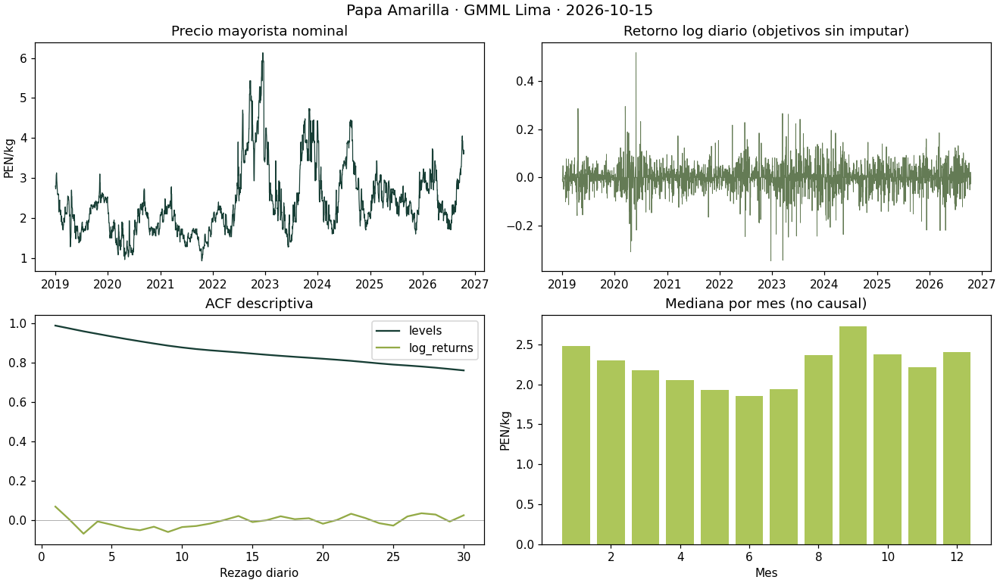
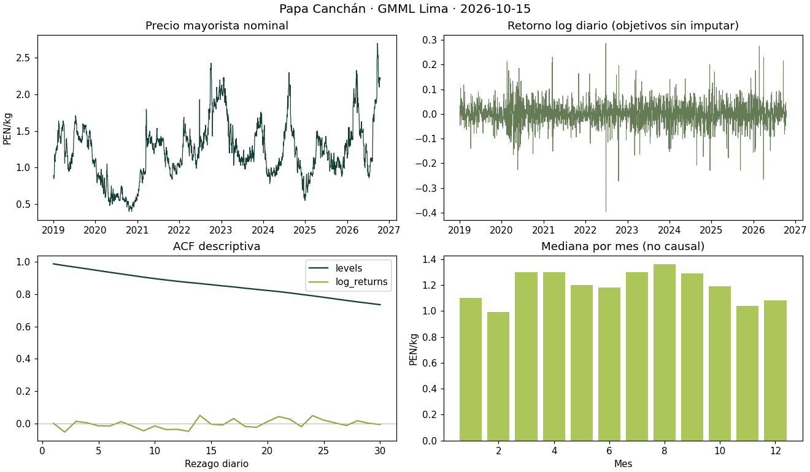
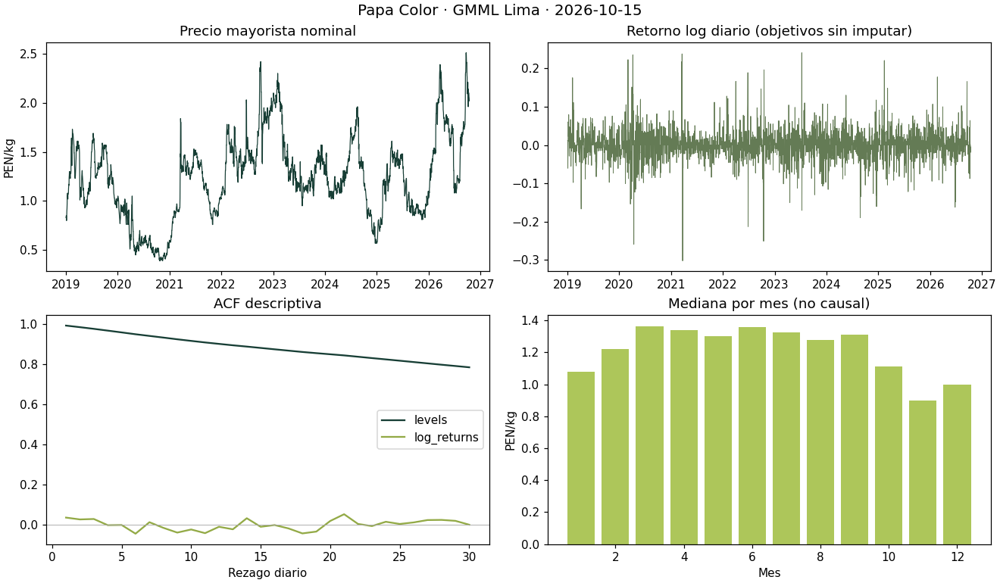
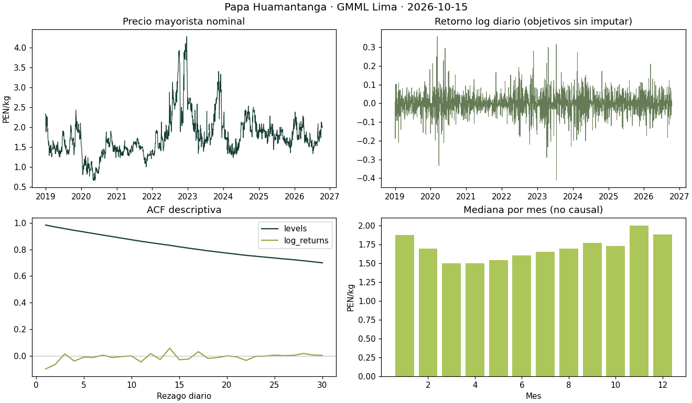
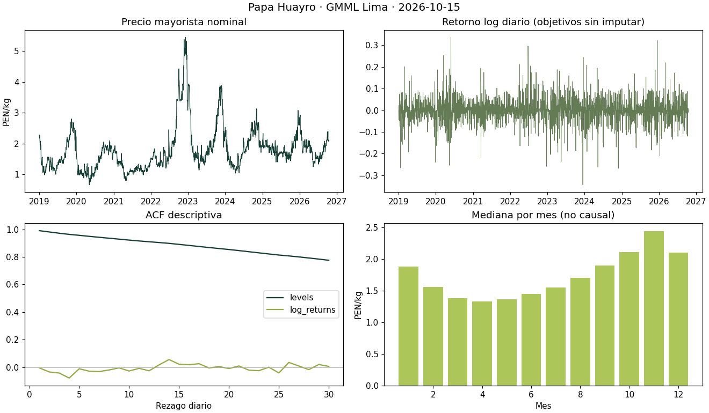
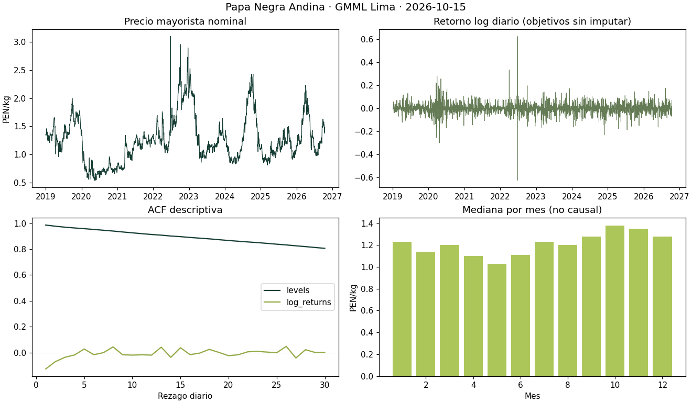
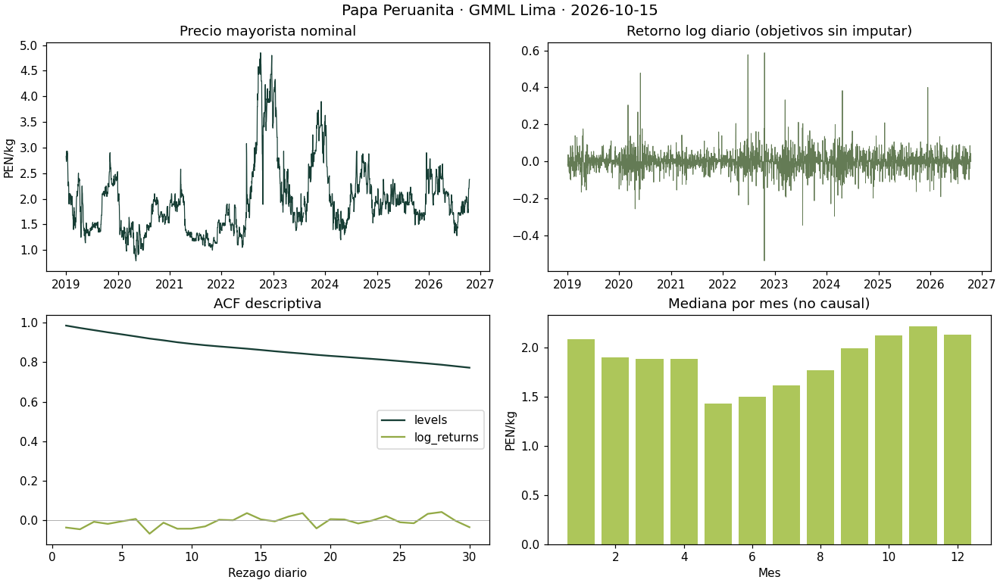
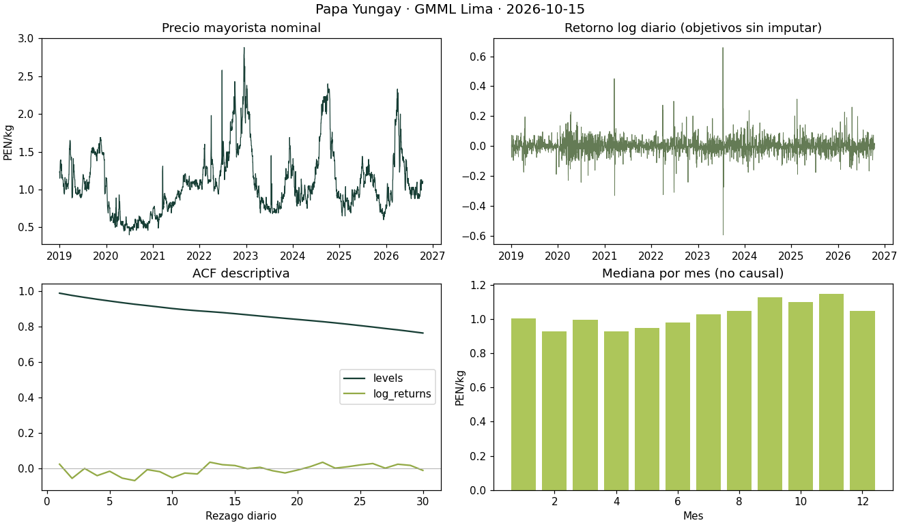
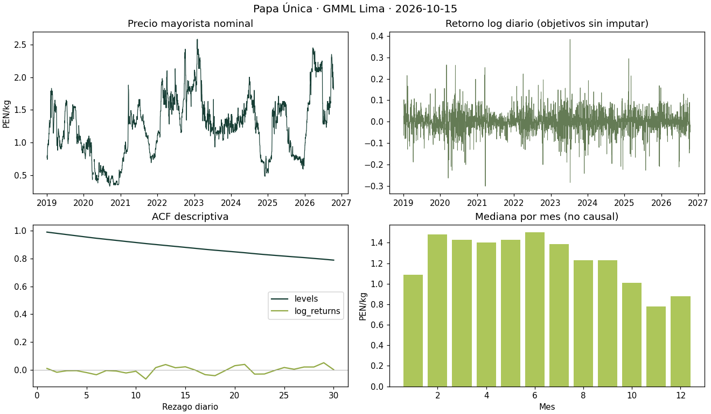

# Diagnóstico por variedad · investigación V5

Ejecución `research-v5-d8d020466b89b190691f`. Datos hasta 2026-10-15; mercado mayorista GMML Lima, PEN/kg nominal. Fecha original de publicación y revisiones SISAP desconocidas.

Estas estadísticas descriptivas no se usan para elegir el ganador. ACF alta no demuestra optimalidad de Naive. Los contrastes ADF/KPSS tienen supuestos; diferencias de régimen y dependencia limitan sus inferencias. Ninguna variedad representa precio en chacra de Tarma.

| Variedad | n | Cobertura diaria | Volumen disponible | ACF(1) nivel | ADF p nivel | KPSS p tabulado | Drift KS |
|---|---:|---:|---:|---:|---:|---:|---:|
| Amarilla | 2843 | 99.9% | 90.5% | 0.9874 | 0.0293 | 0.0100 | 0.335 |

## Amarilla

Rango 2019-01-01–2026-10-15; faltan 2 cotizaciones en la rejilla diaria. Imputación causal ≤7d para ajustar modelos; cero objetivos imputados. Duplicados 0; precios no positivos 0; flags MAD8 0, conservados.

Media 2.402, mediana 2.230, CV 0.355; rango 0.93–6.13 PEN/kg. Drift PSI 0.772 y KS 0.335: descriptivos, no p independiente. Suficiencia de datos: True; latencia de publicación NO VERIFICABLE.

Ficha por horizonte: consultar tabla de evaluación y JSON del run; faltan vintages para deflactar, atribuir shocks o usar volumen/clima/macro como predictores. Cambios mensuales no se etiquetan causalmente como pandemia/El Niño sin evidencia.
| Blanca | 2843 | 99.9% | 100.0% | 0.9885 | 0.0293 | 0.0167 | 0.236 |

## Blanca

Rango 2019-01-01–2026-10-15; faltan 2 cotizaciones en la rejilla diaria. Imputación causal ≤7d para ajustar modelos; cero objetivos imputados. Duplicados 0; precios no positivos 0; flags MAD8 0, conservados.

Media 1.092, mediana 1.030, CV 0.379; rango 0.40–2.88 PEN/kg. Drift PSI 1.377 y KS 0.236: descriptivos, no p independiente. Suficiencia de datos: True; latencia de publicación NO VERIFICABLE.

Ficha por horizonte: consultar tabla de evaluación y JSON del run; faltan vintages para deflactar, atribuir shocks o usar volumen/clima/macro como predictores. Cambios mensuales no se etiquetan causalmente como pandemia/El Niño sin evidencia.
| Canchán | 2843 | 99.9% | 78.4% | 0.9886 | 0.0217 | 0.0100 | 0.310 |

## Canchán

Rango 2019-01-01–2026-10-15; faltan 2 cotizaciones en la rejilla diaria. Imputación causal ≤7d para ajustar modelos; cero objetivos imputados. Duplicados 0; precios no positivos 0; flags MAD8 0, conservados.

Media 1.223, mediana 1.200, CV 0.323; rango 0.40–2.70 PEN/kg. Drift PSI 0.644 y KS 0.310: descriptivos, no p independiente. Suficiencia de datos: True; latencia de publicación NO VERIFICABLE.

Ficha por horizonte: consultar tabla de evaluación y JSON del run; faltan vintages para deflactar, atribuir shocks o usar volumen/clima/macro como predictores. Cambios mensuales no se etiquetan causalmente como pandemia/El Niño sin evidencia.
| Color | 2843 | 99.9% | 54.0% | 0.9922 | 0.0295 | 0.0100 | 0.558 |

## Color

Rango 2019-01-01–2026-10-15; faltan 2 cotizaciones en la rejilla diaria. Imputación causal ≤7d para ajustar modelos; cero objetivos imputados. Duplicados 0; precios no positivos 0; flags MAD8 0, conservados.

Media 1.240, mediana 1.240, CV 0.332; rango 0.39–2.51 PEN/kg. Drift PSI 2.194 y KS 0.558: descriptivos, no p independiente. Suficiencia de datos: True; latencia de publicación NO VERIFICABLE.

Ficha por horizonte: consultar tabla de evaluación y JSON del run; faltan vintages para deflactar, atribuir shocks o usar volumen/clima/macro como predictores. Cambios mensuales no se etiquetan causalmente como pandemia/El Niño sin evidencia.
| Huamantanga | 2841 | 99.9% | 2.0% | 0.9832 | 0.0008 | 0.0100 | 0.396 |

## Huamantanga

Rango 2019-01-01–2026-10-15; faltan 4 cotizaciones en la rejilla diaria. Imputación causal ≤7d para ajustar modelos; cero objetivos imputados. Duplicados 0; precios no positivos 0; flags MAD8 41, conservados.

Media 1.759, mediana 1.680, CV 0.295; rango 0.66–4.28 PEN/kg. Drift PSI 1.194 y KS 0.396: descriptivos, no p independiente. Suficiencia de datos: True; latencia de publicación NO VERIFICABLE.

Ficha por horizonte: consultar tabla de evaluación y JSON del run; faltan vintages para deflactar, atribuir shocks o usar volumen/clima/macro como predictores. Cambios mensuales no se etiquetan causalmente como pandemia/El Niño sin evidencia.
| Huayro | 2843 | 99.9% | 42.3% | 0.9904 | 0.0194 | 0.0100 | 0.338 |

## Huayro

Rango 2019-01-01–2026-10-15; faltan 2 cotizaciones en la rejilla diaria. Imputación causal ≤7d para ajustar modelos; cero objetivos imputados. Duplicados 0; precios no positivos 0; flags MAD8 36, conservados.

Media 1.782, mediana 1.660, CV 0.395; rango 0.66–5.45 PEN/kg. Drift PSI 0.891 y KS 0.338: descriptivos, no p independiente. Suficiencia de datos: True; latencia de publicación NO VERIFICABLE.

Ficha por horizonte: consultar tabla de evaluación y JSON del run; faltan vintages para deflactar, atribuir shocks o usar volumen/clima/macro como predictores. Cambios mensuales no se etiquetan causalmente como pandemia/El Niño sin evidencia.
| Negra Andina | 2843 | 99.9% | 2.5% | 0.9866 | 0.0506 | 0.0215 | 0.188 |

## Negra Andina

Rango 2019-01-01–2026-10-15; faltan 2 cotizaciones en la rejilla diaria. Imputación causal ≤7d para ajustar modelos; cero objetivos imputados. Duplicados 0; precios no positivos 0; flags MAD8 1, conservados.

Media 1.260, mediana 1.200, CV 0.325; rango 0.54–3.10 PEN/kg. Drift PSI 0.838 y KS 0.188: descriptivos, no p independiente. Suficiencia de datos: True; latencia de publicación NO VERIFICABLE.

Ficha por horizonte: consultar tabla de evaluación y JSON del run; faltan vintages para deflactar, atribuir shocks o usar volumen/clima/macro como predictores. Cambios mensuales no se etiquetan causalmente como pandemia/El Niño sin evidencia.
| Peruanita | 2843 | 99.9% | 15.3% | 0.9863 | 0.0134 | 0.0100 | 0.260 |

## Peruanita

Rango 2019-01-01–2026-10-15; faltan 2 cotizaciones en la rejilla diaria. Imputación causal ≤7d para ajustar modelos; cero objetivos imputados. Duplicados 0; precios no positivos 0; flags MAD8 0, conservados.

Media 1.959, mediana 1.880, CV 0.347; rango 0.79–4.85 PEN/kg. Drift PSI 0.748 y KS 0.260: descriptivos, no p independiente. Suficiencia de datos: True; latencia de publicación NO VERIFICABLE.

Ficha por horizonte: consultar tabla de evaluación y JSON del run; faltan vintages para deflactar, atribuir shocks o usar volumen/clima/macro como predictores. Cambios mensuales no se etiquetan causalmente como pandemia/El Niño sin evidencia.
| Yungay | 2843 | 99.9% | 87.9% | 0.9889 | 0.0294 | 0.0163 | 0.236 |

## Yungay

Rango 2019-01-01–2026-10-15; faltan 2 cotizaciones en la rejilla diaria. Imputación causal ≤7d para ajustar modelos; cero objetivos imputados. Duplicados 0; precios no positivos 0; flags MAD8 1, conservados.

Media 1.092, mediana 1.030, CV 0.379; rango 0.40–2.88 PEN/kg. Drift PSI 1.377 y KS 0.236: descriptivos, no p independiente. Suficiencia de datos: True; latencia de publicación NO VERIFICABLE.

Ficha por horizonte: consultar tabla de evaluación y JSON del run; faltan vintages para deflactar, atribuir shocks o usar volumen/clima/macro como predictores. Cambios mensuales no se etiquetan causalmente como pandemia/El Niño sin evidencia.
| Única | 2834 | 99.6% | 80.3% | 0.9908 | 0.0076 | 0.0100 | 0.485 |

## Única

Rango 2019-01-01–2026-10-15; faltan 11 cotizaciones en la rejilla diaria. Imputación causal ≤7d para ajustar modelos; cero objetivos imputados. Duplicados 0; precios no positivos 0; flags MAD8 0, conservados.

Media 1.257, mediana 1.280, CV 0.375; rango 0.33–2.58 PEN/kg. Drift PSI 2.209 y KS 0.485: descriptivos, no p independiente. Suficiencia de datos: True; latencia de publicación NO VERIFICABLE.

Ficha por horizonte: consultar tabla de evaluación y JSON del run; faltan vintages para deflactar, atribuir shocks o usar volumen/clima/macro como predictores. Cambios mensuales no se etiquetan causalmente como pandemia/El Niño sin evidencia.

## Reproducibilidad y límites

`python -m agrodecide.research_v5.run` lee DuckDB una sola vez en modo `read_only=True`, no altera tablas. Las figuras son Matplotlib; JSON guarda percentiles, asimetría, curtosis, ADF/KPSS/ACF/PACF con intervalos, fuerza STL7/365, volatilidad, estacionalidad y relación volumen con retornos7d (exploratoria).

Cobertura = cotizaciones observadas / días entre extremos. Volumen = no nulos / filas. Suficiencia = cobertura≥85%, ≥730 días, último precio válido, ningún hueco>7d. No se presenta una puntuación de confianza inventada: latencia y revisiones desconocidas se registran como tales. La cobertura de la rejilla no certifica operación real todos los días.

No se calculó precio real IPC ni impactos climáticos: los vintages actuales no permiten justificar su disponibilidad histórica. Procedencia, calidad comercial y mercado de origen no están en estos registros. Los outliers se señalan sin eliminarlos.
